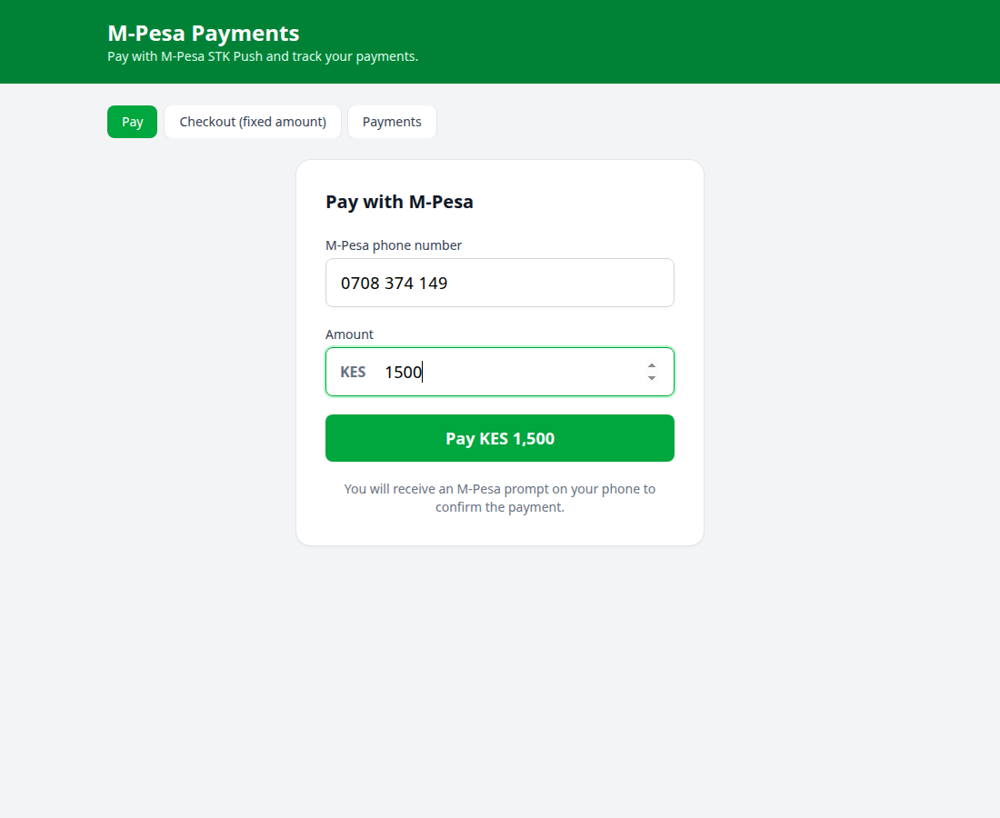
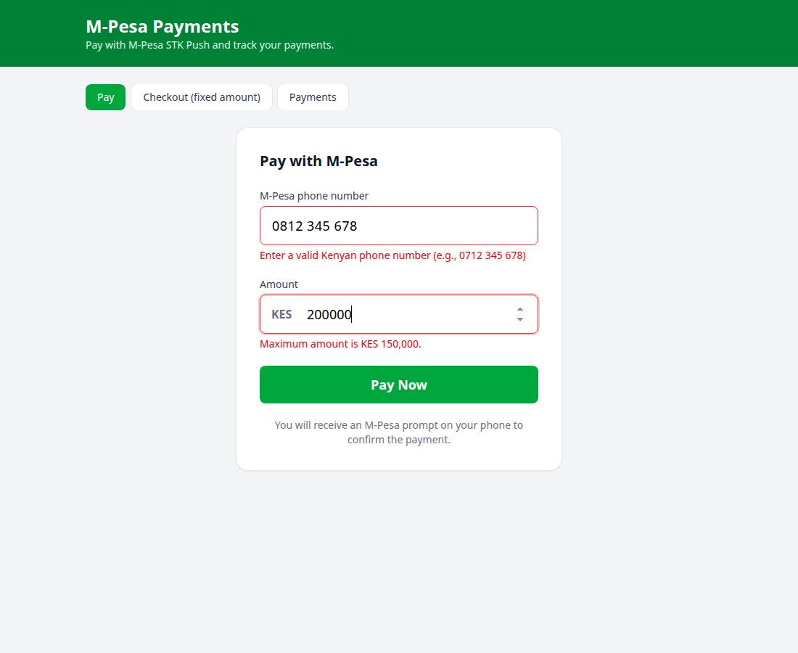
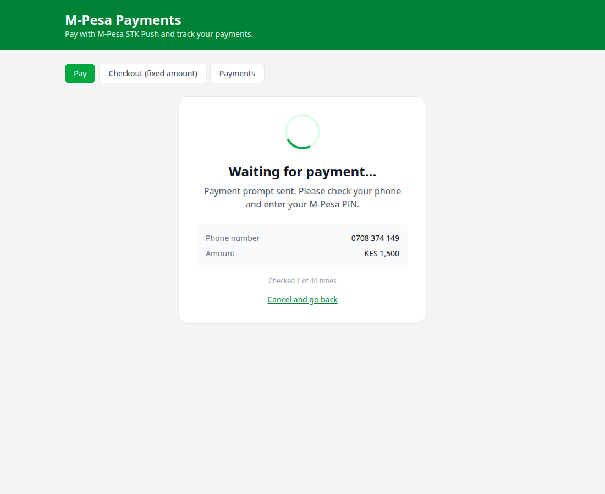
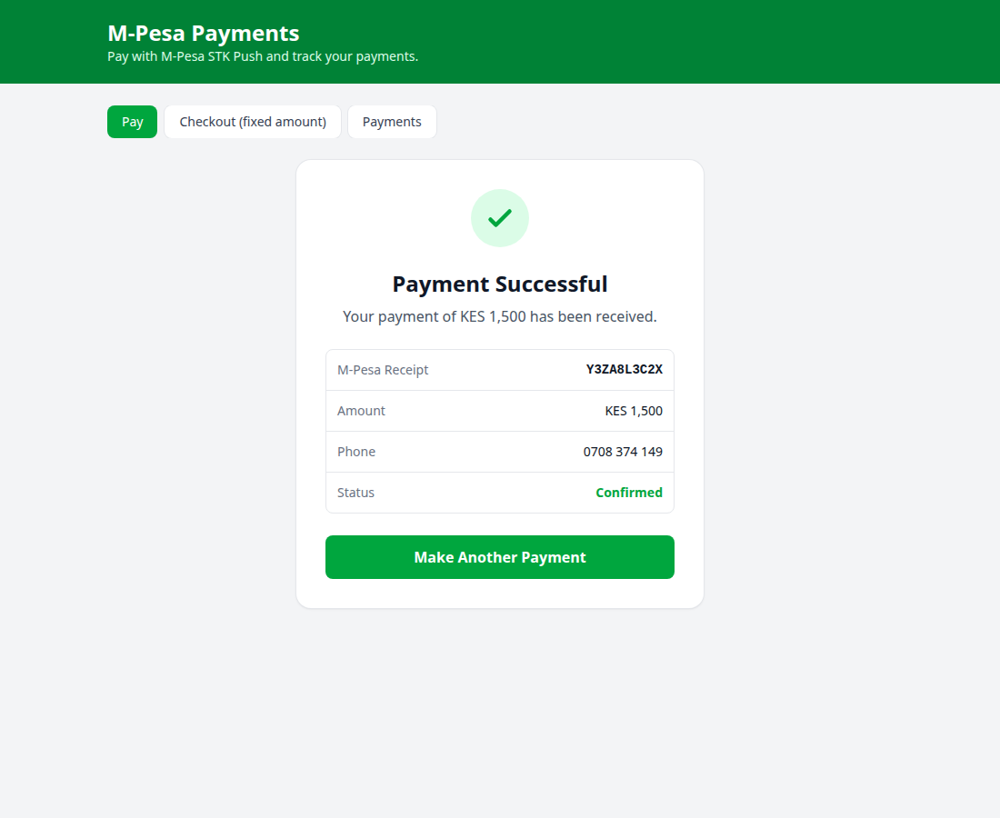
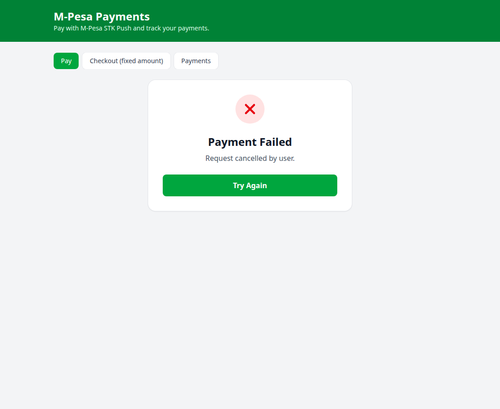
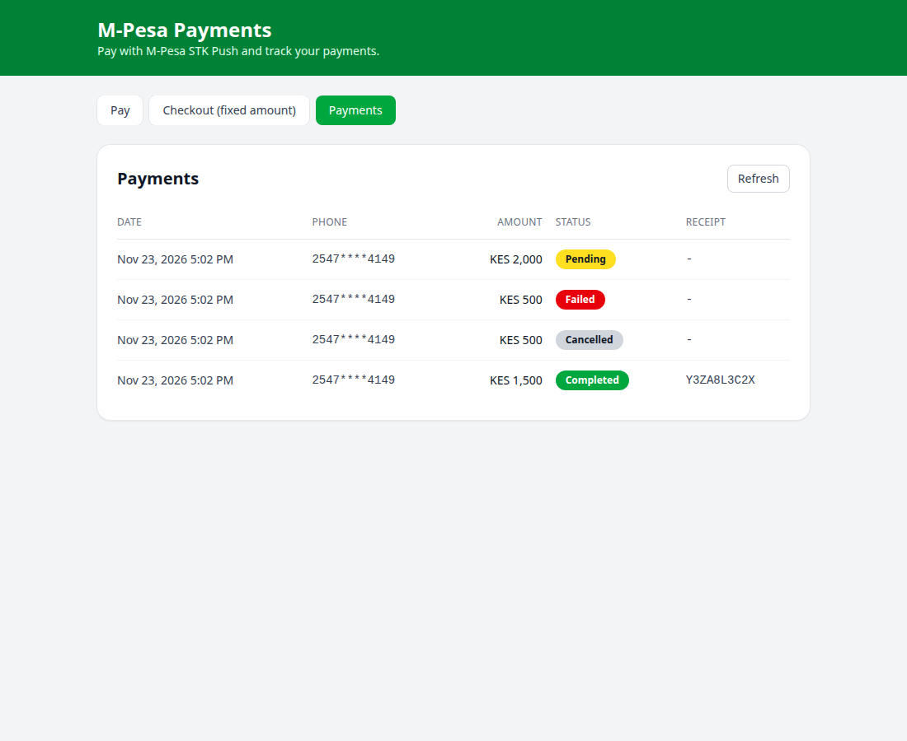
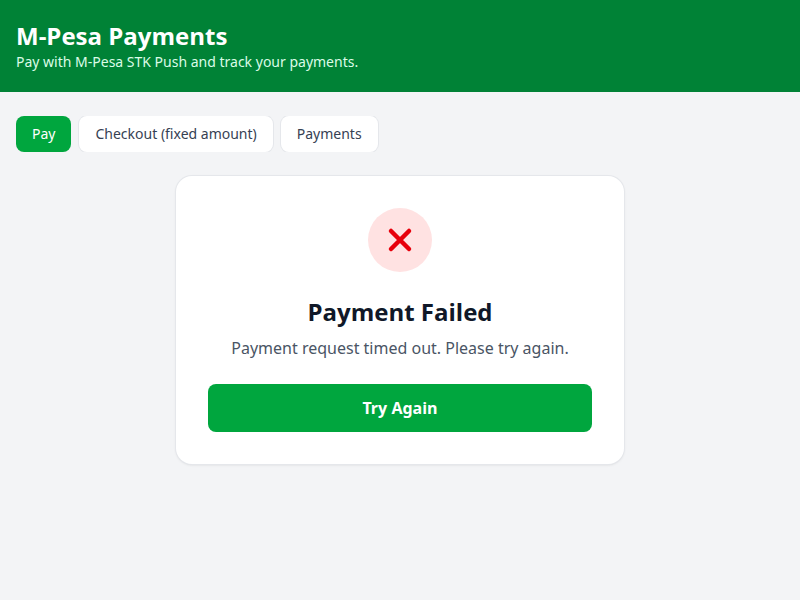

# Week 9 Day 4: Payment Form UI

A React payment page for M-Pesa. You type a phone number and an amount and press Pay. The app sends an STK Push and then checks every 3 seconds whether you paid, until it can show a success screen with the M-Pesa receipt or a failure screen with the reason. A second page lists every payment with colour-coded status badges.

The backend is the Express + Prisma server from Day 3 (STK Push, callbacks, status query), with one new route for polling.



## What's in here

```
week-9-day-4-assignment/
├── server/                     Express API (from Day 3, plus the poll route)
│   ├── server.js               routes, including GET /api/payments/:id/poll
│   ├── mpesa.js                Daraja: token, STK Push, STK Push Query
│   ├── payments.js             callback handling and idempotent status updates
│   ├── phone.js                Kenyan phone number rules
│   ├── prisma/schema.prisma    Payment model
│   ├── scripts/                create a test payment, simulate a Safaricom callback
│   └── test.js                 26 tests (node:test, real database, Daraja faked)
├── client/                     React app (Vite + Tailwind v4)
│   ├── vite.config.js          proxies /api to http://localhost:3000
│   └── src/
│       ├── App.jsx                     tabs: Pay, Checkout (fixed amount), Payments
│       ├── api/payments.js             fetch calls to the API
│       ├── hooks/usePaymentPolling.js  the 3-second polling, with cleanup
│       ├── utils/phone.js              formatting, validation, masking
│       ├── utils/format.js             KES, dates, amount validation
│       └── components/
│           ├── PaymentFlow.jsx         decides which screen to show
│           ├── PaymentForm.jsx         Task 1
│           ├── ProcessingScreen.jsx    Task 2: "Waiting for payment..."
│           ├── SuccessScreen.jsx       Task 2: receipt
│           ├── FailureScreen.jsx       Task 2
│           ├── PaymentsList.jsx        Task 3
│           └── StatusBadge.jsx         Task 3: coloured pills
└── screenshots/
```

## Running it

You need Node 20.19 or newer, PostgreSQL, and Daraja sandbox keys (from Week 9 Day 1).

**1. Server**

```bash
cd server
cp .env.example .env          # then fill in your Daraja keys and DATABASE_URL
npm install                   # also runs prisma generate
npx prisma migrate deploy     # creates the Payment table
npm start                     # http://localhost:3000
```

**2. Client** (in a second terminal)

```bash
cd client
npm install
npm run dev                   # http://localhost:5173
```

Open http://localhost:5173. The React app calls relative URLs like `/api/payments`, and the Vite proxy forwards them to the Express server, so there is no CORS to deal with during development.

**3. Finishing a payment without a real phone**

In the sandbox the prompt goes to Safaricom's test number, not your phone, and Safaricom can only send the callback to a public URL. To finish a payment yourself, take the CheckoutRequestID from the server log (`Payment ws_CO_... pending: KES 1500 ...`) and run:

```bash
cd server
npm run simulate -- ws_CO_XXXXXXXX success      # or: cancelled, failed
```

The screen that is polling switches to success or failure within 3 seconds. The simulator uses the payment's real amount and phone and makes up a receipt number like `Y3ZA8L3C2X`.

To use real callbacks instead, run `ngrok http 3000` and set `MPESA_CALLBACK_URL` in `.env` to `https://<your-ngrok-url>/api/mpesa/callback`.

**Tests**

```bash
cd server && npm test     # 26 tests
cd client && npm run lint && npm run build
```

## Task 1: Payment form

`PaymentForm.jsx`

- **Phone input.** It is `type="tel"`, so phones show the number keypad, and the placeholder is `0712 345 678`. On every keystroke `formatPhoneInput()` removes anything that is not a digit and adds spaces after the 4th and 7th digits: `0712345678` becomes `0712 345 678`. International numbers are grouped as `254 712 345 678` and `+254 712 345 678`.
- **Validation.** `client/src/utils/phone.js` uses the same rules as `server/phone.js` from Day 2. It accepts `07XX`, `01XX`, `254XX` and `+254XX`, and turns them all into `2547XXXXXXXX` before sending. The error "Enter a valid Kenyan phone number (e.g., 0712 345 678)" only shows once 10 digits have been typed, so it doesn't appear while you are still typing. A number starting with 254 needs 12 digits, so the error waits for those too. If you press Pay with a bad number, the error shows straight away.
- **Amount input.** The `KES` prefix is a `<span>` placed absolutely inside the input's wrapper, and the input has extra left padding so the number doesn't sit under it. The input is `type="number"` with `min="1"`, `max="150000"` and `step="1"`. The checks themselves are in `validateAmount()`: required, a whole number, between KES 1 and KES 150,000.
- **fixedAmount prop.** If it is passed, there is no amount input, only a large read-only `KES 1,500`. The "Checkout (fixed amount)" tab shows this with `<PaymentFlow fixedAmount={1500} />`.
- **Pay button.** It is full width, `bg-green-600`, white text, rounded, and shows the amount ("Pay KES 1,500"), or "Pay Now" if the amount isn't valid yet. While the STK Push request is being sent it says "Sending M-Pesa prompt..." and is disabled (`disabled:opacity-50`), so it can't be clicked twice.
- **Enter key.** Everything is inside one `<form onSubmit>`. `event.preventDefault()` stops the page from reloading.
- **API errors.** If the server returns an error (for example Daraja is down, or the server isn't running), its message appears in a red box above the button.
- The helper text under the button reads "You will receive an M-Pesa prompt on your phone to confirm the payment."



## Task 2: Payment status flow

`PaymentFlow.jsx` holds one `step` value: `form`, `processing`, `success` or `failed`. It shows one screen at a time, so the form is replaced by the spinner, not shown next to it.

**Processing screen.** It shows a spinner (a round `border-4` element with one green side and `animate-spin`), "Waiting for payment...", the "check your phone" message, a box with the formatted phone and amount, and a "Cancel and go back" link.



**Polling.** This is in `hooks/usePaymentPolling.js`:

- A `setInterval` calls `GET /api/payments/:id/poll` every 3000 ms.
- `completed` stops polling and goes to the success screen. `failed` and `cancelled` stop polling and go to the failure screen, which shows the API's `resultDesc`.
- After 40 polls (2 minutes) with no answer, it stops and shows "Payment request timed out. Please try again."
- **Cleanup.** The `useEffect` returns a function that sets `stopped = true` and calls `clearInterval`. React runs it when the processing screen unmounts, which happens on Cancel, success or failure, and also if you switch tabs. In testing, 0 poll requests went out after Cancel.
- A slow request doesn't overlap the next one. If the previous poll hasn't come back yet, no new request is sent on that tick. The tick still counts toward the 40, so the 2-minute limit holds even if a request hangs. Each poll request also gives up after 10 seconds (`AbortSignal.timeout(10000)`).
- A network error doesn't end the payment. It counts as one poll and the next tick tries again.
- `onResult` is kept in a ref, so the parent re-rendering doesn't restart the interval.

**Success screen.** It has a green check in a green circle, "Payment Successful", "Your payment of KES 1,500 has been received.", and a receipt box with the M-Pesa receipt, amount, phone and a green "Confirmed". "Make Another Payment" goes back to an empty form.



**Failure screen.** It has a red X in a red circle, "Payment Failed", the `resultDesc` (for example "Request cancelled by user."), and a "Try Again" button. Try Again and Cancel go back to the form with the phone and amount still filled in, so the user doesn't have to type them again. Make Another Payment starts with an empty form.



### The new poll route

`GET /api/payments/:id/poll` takes the `paymentId` that `POST /api/mpesa/stkpush` returns (a CheckoutRequestID also works) and responds with:

```json
{
  "success": true,
  "data": {
    "id": "cmi...",
    "checkoutRequestId": "ws_CO_...",
    "status": "completed",
    "resultDesc": "The service request is processed successfully.",
    "mpesaReceiptNumber": "Y3ZA8L3C2X",
    "amount": 1500,
    "phoneNumber": "254708374149",
    "createdAt": "2026-11-23T14:02:35.000Z"
  }
}
```

Usually the Safaricom callback updates the database and the poll just reads it. But if the callback never comes (for example the callback URL isn't reachable), the payment would stay "pending" forever. So when a payment has been pending for more than 15 seconds, the poll route also asks Daraja's STK Push Query from Day 3, at most once every 10 seconds per payment, because Daraja rate-limits that API. It uses the same `updateIfPending` as the callback, so a late callback and a query result can't overwrite each other.

## Task 3: Payments list

`PaymentsList.jsx` fetches `GET /api/payments` in a `useEffect` when it mounts. An `AbortController` cancels the request if you leave the tab before it finishes.

| Column | How |
|---|---|
| Date | `toLocaleDateString('en-US', { month: 'short', day: 'numeric', year: 'numeric' })` + `toLocaleTimeString('en-US', { hour: 'numeric', minute: '2-digit' })` gives "May 4, 2026 2:30 PM" |
| Phone | `maskPhone()` keeps the first 4 and last 4 digits: `2547****5678` |
| Amount | `KES ${amount.toLocaleString('en-US')}` gives "KES 1,500" |
| Status | `StatusBadge`: completed green/white, pending yellow/dark, failed red/white, cancelled gray/dark |
| Receipt | `mpesaReceiptNumber`, or `-` |

Payments are sorted newest first in the browser as well. The API already sorts them, but the list shouldn't depend on that. While loading, it shows a small spinner with "Loading payments...". With no payments it shows "No payments yet", and if the server can't be reached it shows the error. A Refresh button fetches the list again.



## How I tested it

- `npm test` in `server/`: all 26 tests pass. These are the 20 Day 3 tests plus 6 for the poll route: 404, a new pending payment doesn't call Daraja, completed with receipt (by paymentId and by CheckoutRequestID), cancelled with resultDesc, the Daraja query only happens once per 10 seconds, and a Daraja 1032 is saved as cancelled.
- In headless Chrome (puppeteer), against the real Daraja sandbox, I sent four STK Pushes to the test number 254708374149 and finished them with the simulator. Checks:
  - "No payments yet" on an empty list
  - `0812 345 678` shows the phone error, and KES 200,000 shows "Maximum amount is KES 150,000."
  - Typing `254708374149` shows no early error
  - The button reads "Pay KES 1,500", and pressing Enter in the amount field submits
  - success shows the receipt
  - cancelled shows "Request cancelled by user."
  - insufficient balance shows "The balance is insufficient for the transaction."
  - Try Again keeps the values, and Cancel stops polling (0 requests afterwards)
  - fixedAmount hides the amount input
  - The list shows all four statuses with the right colours, masked phones and the receipt
- Timeout: I faked the API so every poll returned "pending". The app made exactly 40 polls, showed "Payment request timed out. Please try again." after about 2 minutes, and sent no more requests after that.
- Hung request: I made one poll request never answer. The app still timed out at about 2 minutes. My first version didn't: it skipped every tick while waiting for the stuck request, so it never reached 40. That is why the ticks are now counted, not the requests.
- `npm run lint` (oxlint) and `npm run build` pass.



## Notes

- **"Cancel and go back" only stops this page from waiting.** It can't take back the prompt on the phone, because M-Pesa has no API for that. If the customer still pays, the callback records it and it shows as Completed in the payments list.
- The phone validation is in the client and the server. The client gives fast feedback, and the server still rejects bad numbers if someone calls the API directly.
- Dates are shown in the browser's time zone. In Kenya that is EAT (UTC+3).
